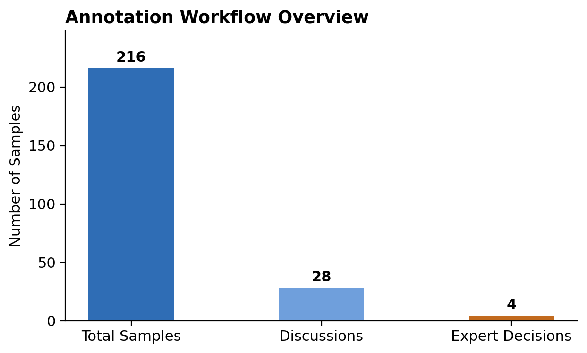
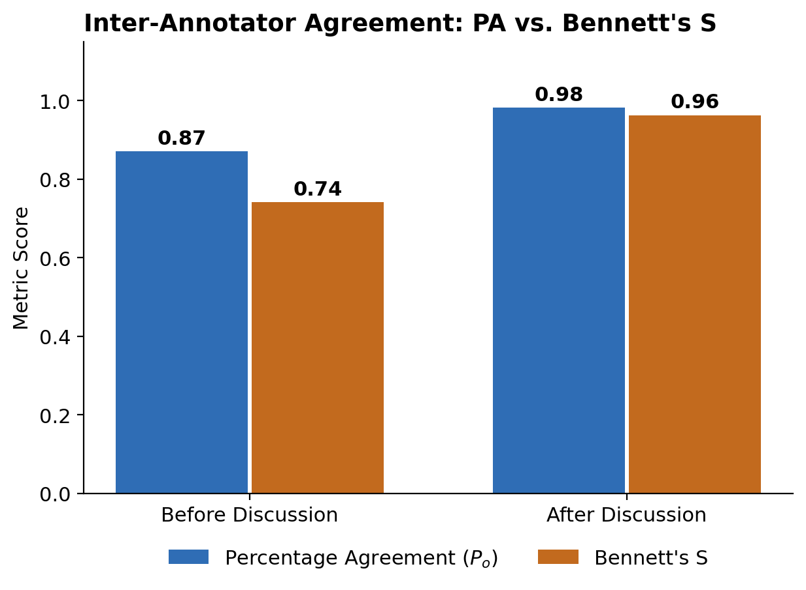
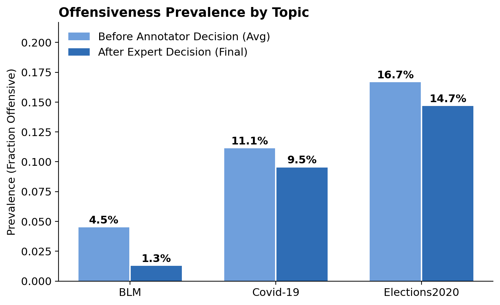

# BSEM — Data Annotation & Dataset Evaluation

[](https://github.com/daniilperkin-uni/bsem/actions/workflows/validate.yml)
[](LICENSE)
[](requirements.txt)

University seminar project (B.Sc.) on data-centric AI: how reliable are human annotations,
and how do you evaluate a computer-vision dataset before you train on it?

**Live write-up:** [uni-old-projects → BSEM](https://daniilperkin-uni.github.io/uni-old-projects/#bsem) · **Slides:** [v1.0.0 release](https://github.com/daniilperkin-uni/bsem/releases/tag/v1.0.0)

**Start here:** [`annotated_data_analysis.ipynb`](annotation_experiment/annotated_data_analysis.ipynb) (GitHub renders the outputs) · [`DatasetEvaluation.md`](dataset_evaluation/DatasetEvaluation.md)

> **Content warning:** the datasets contain tweets (topics: BLM, Covid-19, Elections 2020)
> with offensive language, slurs and profanity.

## What's in here

| Part | What it does |
|---|---|
| `annotation_experiment/` | Our annotation experiment: 216 tweets, two annotators, discussion, expert adjudication — plus the agreement-metrics work (Bennett's S, Cohen's kappa, Gwet's AC1) and prevalence-paradox simulations |
| `dataset_evaluation/` | A 76-criterion audit of **Microsoft COCO** vs **SA-1B (Segment Anything)** across annotation planning, data sourcing, ethics, quality assurance and adjudication |



## Results at a glance

| Metric (n = 216) | Before discussion | Final |
|---|---|---|
| Percentage agreement | 0.870 | 0.981 |
| Bennett's S | 0.741 | 0.963 |
| Gwet's AC1 | 0.840 | 0.978 |
| Cohen's kappa | 0.321 | 0.885 |

Against the original labels: PA 91.7% (198/216), AC1 0.90 (trivial baseline 0.89), kappa 0.50.

## Highlights

**Inter-annotator agreement — discussion closes the gap.** Percentage agreement rises
0.87 → 0.98 and Bennett's S 0.74 → 0.96 between the first pass and the post-discussion labels.



**The prevalence paradox.** With rare positives, Cohen's kappa collapses (0.32) while
Bennett's S stays high (0.74) on the very same labels. The simulation notebooks
(`task2_fake_data.ipynb`, `task3_metrics_comparison.ipynb`) show why: kappa is 0 for pure
guessing regardless of prevalence, while S rises with skew — at 5% prevalence, guessing
alone reaches S = 0.81.



**Agreement with the original labels** (n = 216): PA 91.7%, AC1 0.90 against a trivial
"never offensive" baseline of 0.89, kappa 0.50 — so agreement on the rare offensive cases
is only moderate, with a clear topical pattern (BLM missed, Elections 2020 over-labelled).

**Dataset audit:** COCO vs SA-1B on 76 criteria — COCO is the better fit for scene
understanding (semantic categories per object); SA-1B wins on boundary quality (94% of
mask pairs > 90% IoU against professionally corrected masks) but has no categories at all.

## Repository layout

```
annotation_experiment/     our annotation experiment
  annotated_data/          labels + batch metadata (discussion chat logs removed)
  original_data/           original labels used for comparison
  example_data/            small example batches for the exercise notebooks
  figures/                 figures exported by the analysis notebook
  presentation/            result slides (.pptx / .pdf)
  annotated_data_analysis.ipynb   the main analysis
  task1_analysis.ipynb            agreement metrics on the example batch
  task2_fake_data.ipynb           synthetic prevalence experiments
  task3_metrics_comparison.ipynb  metric comparison across prevalences
  task3A_example_prevalence.ipynb prevalence on the example batch
dataset_evaluation/        COCO vs SA-1B audit
```

## Run it

```
pip install -r requirements.txt
jupyter lab
```

Open `annotation_experiment/annotated_data_analysis.ipynb` and run all cells — it works
from the repository root or from the folder itself, checks the data with assertions and
writes the figures to `annotation_experiment/figures/`.

## Data & provenance

The tweets, the example batches and the original benchmark labels were provided as part
of the course; the discussion chat logs were removed from the published data files (only
labels, timestamps and batch metadata remain). No usernames, user IDs or media URLs are
included: `text_id` is a local row identifier and links in the tweet text were replaced
with `<url>`. Paper PDFs are not redistributed — the evaluation only cites their arXiv IDs.

## Limitations

- 216 tweets, two annotators and one expert: enough to demonstrate the mechanism, not to estimate
  agreement for a population of annotators.
- Cohen's kappa is unstable when positives are rare (10.6% of labels before discussion);
  Bennett's S is prevalence-robust by construction. We report both instead of picking one.
- The codebook changed during the experiment (the batch-6 dip in the per-batch curve); the curve
  shows the effect but cannot separate the codebook revision from batch difficulty.

## Next steps

- **Confidence intervals.** All agreement numbers are point estimates; bootstrap CIs (items resampled,
  10k draws) would show whether 0.321 → 0.885 is distinguishable from noise at n = 216.
- **More annotators.** Two annotators and one expert only support pairwise kappa; 4–5 annotators would
  allow Fleiss' kappa / Krippendorff's alpha and annotator-level error modelling (Dawid–Skene).
- **Freeze the codebook first.** The revision landed mid-experiment (batch 6); pre-registering the
  codebook and re-rating the same items after a change would separate the codebook effect from batch
  difficulty.
- **One tested metrics module.** The same agreement math is re-implemented in five notebooks; extracting
  `bsem/metrics.py` with unit tests and importing it everywhere would remove that drift.
- **Execute the notebooks in CI.** The current job validates data and notebook JSON; running the
  notebooks headless and diffing outputs would turn "reproducible" from a claim into a gate.

## Credits & license

Course project by a student group (Group 1); teammates are anonymized. Code: MIT (see
`LICENSE`). Written content and slides: CC BY 4.0. The provided data files are included
for reproducibility without asserting a license on them.
